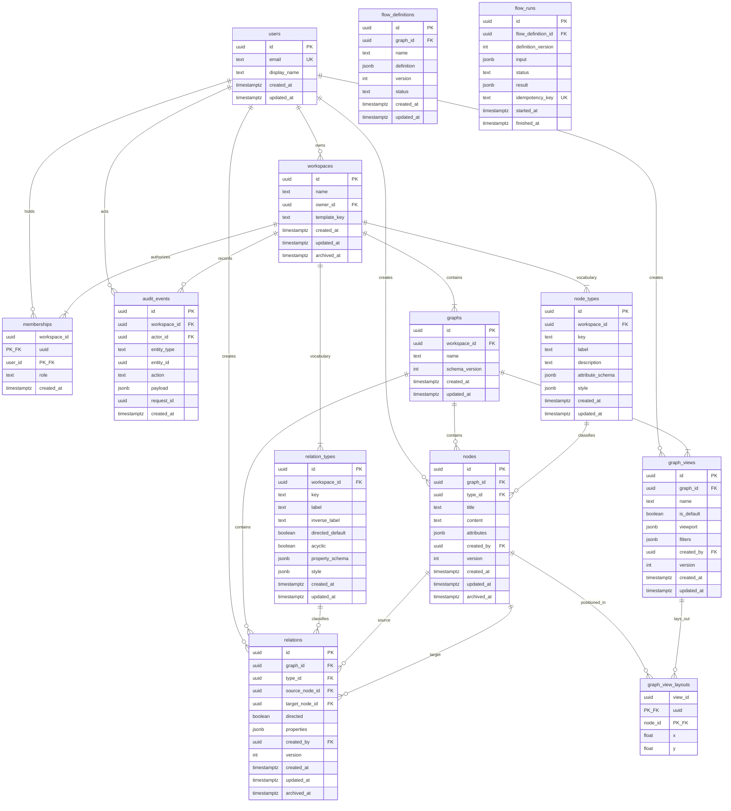

# Modelo de dados

DER inicial do Nexus. Tabelas da Fase 1 (MVP individual) entram no primeiro schema; `flow_definitions` e `flow_runs` existem no desenho para deixar explícita a fronteira com execução, mas **não** são migradas agora.

Convenções: UUID v4, timestamps `timestamptz`, JSONB só para atributos flexíveis já validados pelo schema do tipo, `version` inteiro para concorrência otimista nas entidades editáveis.

## Decisões travadas neste DER

| Decisão | Escolha | Por quê |
|---|---|---|
| Graph vs workspace | Tabela `graphs` desde o dia 1; MVP cria exatamente um graph por workspace | Workspace é acesso e vocabulário; graph é o conhecimento. Dropar a distinção agora barateia pouco e custa caro depois |
| Tipos | `node_types` e `relation_types` por workspace | Ver ADR 0002 |
| Templates | Semente em código, copiada na criação do workspace | Evita tabelas de catálogo antes de haver templates de usuário |
| Layout | `graph_view_layouts` (uma linha por node na view) | A geometria não é o domínio; atualizar x/y não deve versionar o node |
| Exclusão | Arquivar node e relations incidentes (`archived_at`); hard delete só com o workspace | Preserva integridade e permite restaurar; FK nunca aponta para linha ausente |
| Relations paralelas | Permitidas | Dois “aliado de” com vigências diferentes são afirmações distintas |
| Ciclos | Válidos no graph; só `relation_types.acyclic = true` é tratado como DAG | Aliança e referência cíclica são conteúdo normal |
| Auth | `users` + `memberships` mesmo no uso solo | Auditoria e RF-07 nascem corretos; o MVP semeia um owner |
| Flows | Fora da migração do MVP | Relation não ganha coluna de efeito |

## DER



`flow_definitions` e `flow_runs` são Fase 4. Não criar essas tabelas no MVP.

## Tabelas (MVP)

### `users`

Identidade do ator. Credenciais (hash, OAuth, sessão) ficam fora deste modelo até a escolha do provedor.

| Coluna | Tipo | Regras |
|---|---|---|
| id | uuid | PK |
| email | text | UNIQUE, NOT NULL |
| display_name | text | NOT NULL |
| created_at, updated_at | timestamptz | NOT NULL |

### `workspaces`

| Coluna | Tipo | Regras |
|---|---|---|
| id | uuid | PK |
| name | text | NOT NULL |
| owner_id | uuid | FK `users`, NOT NULL |
| template_key | text | `'knowledge'` ou `'worldbuilding'` na criação |
| created_at, updated_at | timestamptz | NOT NULL |
| archived_at | timestamptz | NULL = ativo |

Criar workspace, no mesmo transaction: membership `owner`, graph inicial, cópia dos tipos do template, view default.

### `memberships`

| Coluna | Tipo | Regras |
|---|---|---|
| workspace_id | uuid | PK composta, FK `workspaces` ON DELETE CASCADE |
| user_id | uuid | PK composta, FK `users` |
| role | text | `owner` \| `editor` \| `viewer` |
| created_at | timestamptz | NOT NULL |

O `owner_id` do workspace deve ter uma membership `owner`. Transferência de dono atualiza os dois no mesmo transaction.

### `graphs`

| Coluna | Tipo | Regras |
|---|---|---|
| id | uuid | PK |
| workspace_id | uuid | FK `workspaces` ON DELETE CASCADE, NOT NULL |
| name | text | NOT NULL |
| schema_version | int | NOT NULL, default 1 (versão do formato de exportação) |
| created_at, updated_at | timestamptz | NOT NULL |

Sem UNIQUE em `workspace_id`: o MVP cria um; múltiplos graphs continuam possíveis sem migração estrutural.

### `node_types` / `relation_types`

Vocabulário do workspace. UNIQUE `(workspace_id, key)`.

`attribute_schema` / `property_schema` são JSON Schema. A aplicação valida `nodes.attributes` e `relations.properties` contra o schema do tipo **antes** de gravar.

`relation_types.acyclic = true` (ex.: `prerequisite`) é a única família em que criar a aresta pode ser rejeitado por ciclo. O resto do graph aceita ciclos.

Não apagar tipo em uso: se existe node/relation apontando para ele, a exclusão é bloqueada. Arquivar tipo pode esperar Fase 2.

### `nodes`

| Coluna | Tipo | Regras |
|---|---|---|
| id | uuid | PK |
| graph_id | uuid | FK `graphs` ON DELETE CASCADE |
| type_id | uuid | FK `node_types` RESTRICT |
| title | text | NOT NULL |
| content | text | NOT NULL, default `''` (Markdown) |
| attributes | jsonb | NOT NULL, default `{}` |
| created_by | uuid | FK `users` |
| version | int | NOT NULL, default 1; incrementa a cada update |
| created_at, updated_at | timestamptz | NOT NULL |
| archived_at | timestamptz | NULL = visível no graph |

Invariante de aplicação: `node_types.workspace_id` = `graphs.workspace_id` do node.

### `relations`

| Coluna | Tipo | Regras |
|---|---|---|
| id | uuid | PK |
| graph_id | uuid | FK `graphs` ON DELETE CASCADE |
| type_id | uuid | FK `relation_types` RESTRICT |
| source_node_id | uuid | FK `nodes` RESTRICT |
| target_node_id | uuid | FK `nodes` RESTRICT |
| directed | boolean | NOT NULL; default vem do tipo, pode ser override |
| properties | jsonb | NOT NULL, default `{}` |
| created_by | uuid | FK `users` |
| version | int | NOT NULL, default 1 |
| created_at, updated_at | timestamptz | NOT NULL |
| archived_at | timestamptz | NULL = visível |

Invariantes de aplicação:

1. `source` e `target` pertencem ao mesmo `graph_id` da relation.
2. `relation_types.workspace_id` = workspace do graph.
3. Arquivar um node arquiva as relations em que ele é source ou target.
4. Recusar relation cujo tipo é `acyclic` se o novo caminho fechar ciclo nesse subgrafo.

Self-loop é permitido. Não há UNIQUE em (source, target, type): relations paralelas são conteúdo.

### `graph_views`

| Coluna | Tipo | Regras |
|---|---|---|
| id | uuid | PK |
| graph_id | uuid | FK `graphs` ON DELETE CASCADE |
| name | text | NOT NULL |
| is_default | boolean | NOT NULL, default false |
| viewport | jsonb | `{ x, y, zoom }` |
| filters | jsonb | tipos, texto, grupos |
| created_by | uuid | FK `users` |
| version | int | NOT NULL, default 1 |
| created_at, updated_at | timestamptz | NOT NULL |

Índice único parcial: um `is_default = true` por `graph_id`.

### `graph_view_layouts`

Posição de um node em uma view. ON DELETE CASCADE nos dois lados: apagar a view ou o node some com a geometria, não com o significado.

| Coluna | Tipo | Regras |
|---|---|---|
| view_id | uuid | PK composta, FK `graph_views` |
| node_id | uuid | PK composta, FK `nodes` |
| x, y | double precision | NOT NULL |

Node novo: o canvas grava layout só na view corrente. Outras views posicionam na primeira abertura (centro do viewport ou auto-layout futuro).

### `audit_events`

Imutável. Sem `updated_at`. Sem FK polimórfica em `entity_id`.

Ações mínimas do MVP: `WorkspaceCreated`, `NodeCreated`, `NodeUpdated`, `NodeArchived`, `RelationCreated`, `RelationUpdated`, `RelationArchived`, `ViewUpdated`, `ImportCompleted`.

Gravar o evento **na mesma transação** da mutação. Isso não é event sourcing: o estado canônico continua nas tabelas de domínio.

## Índices

```
memberships (user_id)
graphs (workspace_id)
node_types (workspace_id, key) UNIQUE
relation_types (workspace_id, key) UNIQUE
nodes (graph_id) WHERE archived_at IS NULL
nodes (graph_id, type_id)
nodes (graph_id, title)            -- busca; pg_trgm na Fase 2 se precisar
relations (graph_id) WHERE archived_at IS NULL
relations (source_node_id)
relations (target_node_id)
relations (graph_id, type_id)
graph_views (graph_id)
graph_view_layouts (node_id)
audit_events (workspace_id, created_at DESC)
audit_events (entity_id)
```

Consultas de vizinhança: começar por `relations` filtradas por `source_node_id` / `target_node_id`, profundidade limitada na aplicação (1 salto, expansão depois). CTE recursiva só com `max_depth` e teto de linhas.

## O que este modelo recusa

- Coluna de efeito em `relations` (disparar tarefa, status, webhook).
- Guardar o graph inteiro em um JSON por workspace.
- Posição x/y em `nodes`.
- Tipo como string livre sem linha em `*_types`.
- Hard delete de node com relations vivas.
- Tabelas de CRDT, presença ou cursor no MVP.
- Cobertura percentual de ciclo universal: ciclo só importa quando o **tipo** pede DAG.

## Mapeamento para exportação (`nexus-graph` schemaVersion 1)

| JSON | Origem |
|---|---|
| `workspace.name` | `workspaces.name` |
| `graph.name` | `graphs.name` |
| `nodes[].id, title, content, attributes` | `nodes` |
| `nodes[].type` | `node_types.key` |
| `relations[].source/target/type/directed/properties` | `relations` + `relation_types.key` |
| `views[]` | `graph_views` + `graph_view_layouts` |

IDs externos são remapeados na importação; referências internas do arquivo se preservam. Validar schema, tamanho e FKs internas **antes** de gravar, numa única transação.
